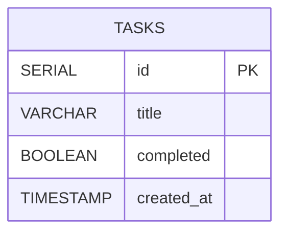

# ER-диаграмма Task Manager

## Описание таблицы tasks

| Поле | Тип | Назначение |
|---|---|---|
| id | SERIAL | Первичный ключ |
| title | VARCHAR(255) | Название задачи |
| completed | BOOLEAN | Статус выполнения |
| created_at | TIMESTAMP | Дата создания |

Связи с другими таблицами отсутствуют.
